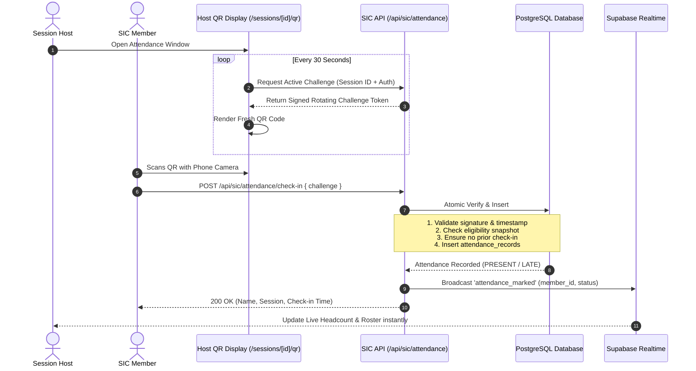

# SIC Unified Attendance & Operations Management System
## Unified Attendance Rules & Rotating QR Engine

### 1. Attendance Scope & Uniqueness Rule

#### 1.1 The Multi-Group Attendance Axiom
> **Critical Rule:** In any combined session (e.g. Group A + Group B), an individual member may belong to multiple participating groups, but **MUST ONLY be counted once** in the session register and live headcount.

* **Database Guarantee:**
  ```sql
  CONSTRAINT unique_session_attendance UNIQUE (session_id, member_id)
  ```
* **Eligibility Deduplication:** When scheduling a session, the system queries all participating groups and snapshots the unique eligible members:
  ```sql
  SELECT DISTINCT gm.member_id 
  FROM group_memberships gm
  WHERE gm.group_id IN (SELECT group_id FROM session_groups WHERE session_id = $1)
    AND gm.status = 'ACTIVE';
  ```

#### 1.2 Status State Transitions
```
                [NOT_MARKED]
                     │
      ┌──────────────┴──────────────┐
      ▼                             ▼
  [PRESENT]                     [LATE] (after grace period)
      │                             │
      └──────────────┬──────────────┘
                     │
         (Correction Requested)
                     ▼
        [PENDING_VERIFICATION]
                     │
        ┌────────────┴────────────┐
        ▼                         ▼
   [EXCUSED]                [INVALIDATED]
```

---

### 2. Cryptographic Rotating QR Specification

#### 2.1 Threat Model
* **Threat 1: Screenshot Forwarding / Remote Check-in:** A member in the room photographs the QR and sends it via WhatsApp/Telegram to absent peers.
* **Threat 2: Replay Attacks:** A student intercepts a past challenge URL and submits it multiple times.
* **Threat 3: Clock Drift:** Client device clocks manipulated to bypass expiration.

#### 2.2 Rotating HMAC Challenge Architecture
1. **Server-Generated Tokens:**
   * The challenge token is generated on the server using HMAC-SHA256:
     ```ts
     const payload = `${sessionId}:${intervalTimestamp}:${nonce}`;
     const signature = crypto.createHmac('sha256', SECRET_KEY).update(payload).digest('hex');
     const challenge = `${payload}:${signature}`;
     ```
2. **Short Rotation Cycle:**
   * Default: **30 seconds** (configurable to 15s or 60s).
   * Valid grace window: Tolerates ±1 interval drift (max 30s beyond displayed frame).
3. **Single-Use Challenge Nonce Table:**
   * Each token includes a random 16-byte nonce.
   * On check-in, the challenge nonce is written atomically.
   * If the nonce has already been utilized or the interval expired, the check-in is rejected.
4. **Physical Presence Augmentation (Optional/Configurable):**
   * Geofencing validation against venue GPS coords (with browser Geolocation API consent).
   * Host supervisor verification toggle for sensitive workshops or executive meetings.

---

### 3. Verification Sequence Flow


