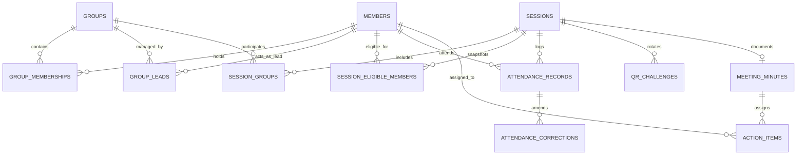

# SIC Unified Attendance & Operations Management System
## Database Schema Specification

### 1. Architectural Principles
* **Primary Keys:** UUID v4 (`gen_random_uuid()`) across all tables.
* **Timestamps:** Standardized `created_at` and `updated_at` with `TIMESTAMPTZ` defaulting to `now()`.
* **Tenant / Org Isolation:** Single organization core (`organization = 'SIC'`), scoped through Row Level Security (RLS).
* **Attendance Uniqueness:** Strict database constraint `UNIQUE(session_id, member_id)` to guarantee zero duplicate headcounts even across combined multi-group meetings.
* **Soft Deletion / History:** Membership removals and role changes archive historical records with `ended_at` rather than destructive physical deletions.

---

### 2. Entity Relationship Overview

---

### 3. Detailed Table Definitions

#### 3.1 Identity & Access Control
* **`members`**:
  * `id`: UUID (PK)
  * `auth_user_id`: UUID (FK -> auth.users) UNIQUE NULLABLE
  * `member_code`: VARCHAR(32) UNIQUE NOT NULL (e.g., `SIC-2027-001`)
  * `full_name`: VARCHAR(255) NOT NULL
  * `email`: VARCHAR(255) UNIQUE NOT NULL
  * `phone`: VARCHAR(32)
  * `avatar_url`: TEXT
  * `department`: VARCHAR(128) NOT NULL
  * `designation`: VARCHAR(128) NOT NULL
  * `org_role`: VARCHAR(64) DEFAULT 'MEMBER' -- 'SUPER_ADMIN', 'SIC_DIRECTOR', 'SIC_ADMIN', 'OPERATIONS_MANAGER', 'ATTENDANCE_AUDITOR', 'MEMBER'
  * `status`: VARCHAR(32) DEFAULT 'ACTIVE' -- 'ACTIVE', 'INACTIVE', 'SUSPENDED'
  * `joining_date`: DATE DEFAULT CURRENT_DATE
  * `created_at`: TIMESTAMPTZ DEFAULT now()
  * `updated_at`: TIMESTAMPTZ DEFAULT now()

* **`groups`**:
  * `id`: UUID (PK)
  * `name`: VARCHAR(255) NOT NULL
  * `code`: VARCHAR(64) UNIQUE NOT NULL
  * `description`: TEXT
  * `group_type`: VARCHAR(64) DEFAULT 'PERMANENT' -- 'PERMANENT', 'TEMPORARY', 'PROJECT', 'EVENT', 'WORKSHOP'
  * `parent_group_id`: UUID (FK -> groups.id) NULLABLE
  * `is_active`: BOOLEAN DEFAULT true
  * `capacity_limit`: INTEGER DEFAULT 0 -- 0 indicates unlimited
  * `attendance_policy`: JSONB DEFAULT '{"grace_period_mins": 15, "min_attendance_pct": 75}'
  * `created_by`: UUID (FK -> members.id)
  * `created_at`: TIMESTAMPTZ DEFAULT now()
  * `updated_at`: TIMESTAMPTZ DEFAULT now()

* **`group_memberships`**:
  * `id`: UUID (PK)
  * `group_id`: UUID (FK -> groups.id) NOT NULL
  * `member_id`: UUID (FK -> members.id) NOT NULL
  * `status`: VARCHAR(32) DEFAULT 'ACTIVE' -- 'ACTIVE', 'SUSPENDED', 'LEFT'
  * `joined_at`: TIMESTAMPTZ DEFAULT now()
  * `ended_at`: TIMESTAMPTZ NULLABLE
  * `added_by`: UUID (FK -> members.id)
  * UNIQUE (`group_id`, `member_id`, `status`)

* **`group_leads`**:
  * `id`: UUID (PK)
  * `group_id`: UUID (FK -> groups.id) NOT NULL
  * `member_id`: UUID (FK -> members.id) NOT NULL
  * `lead_type`: VARCHAR(32) DEFAULT 'PRIMARY_LEAD' -- 'PRIMARY_LEAD', 'CO_LEAD'
  * `assigned_at`: TIMESTAMPTZ DEFAULT now()
  * `assigned_by`: UUID (FK -> members.id)
  * `is_active`: BOOLEAN DEFAULT true
  * UNIQUE (`group_id`, `member_id`)

#### 3.2 Sessions & Unified Attendance
* **`sessions`**:
  * `id`: UUID (PK)
  * `title`: VARCHAR(255) NOT NULL
  * `description`: TEXT
  * `session_type`: VARCHAR(64) NOT NULL -- 'DAILY_DUTY', 'GROUP_MEETING', 'MULTI_GROUP_MEETING', 'GENERAL_MEETING', 'WORKSHOP', 'EVENT'
  * `host_id`: UUID (FK -> members.id) NOT NULL
  * `status`: VARCHAR(32) DEFAULT 'SCHEDULED' -- 'DRAFT', 'SCHEDULED', 'OPEN', 'IN_PROGRESS', 'CLOSED', 'RECONCILED', 'FINALIZED', 'CANCELLED'
  * `scheduled_start`: TIMESTAMPTZ NOT NULL
  * `scheduled_end`: TIMESTAMPTZ NOT NULL
  * `venue`: VARCHAR(255)
  * `meeting_link`: TEXT
  * `qr_active_from`: TIMESTAMPTZ
  * `qr_active_to`: TIMESTAMPTZ
  * `qr_rotation_interval_sec`: INTEGER DEFAULT 30
  * `late_grace_period_mins`: INTEGER DEFAULT 15
  * `require_location`: BOOLEAN DEFAULT false
  * `created_by`: UUID (FK -> members.id)
  * `created_at`: TIMESTAMPTZ DEFAULT now()

* **`session_groups`**:
  * `session_id`: UUID (FK -> sessions.id) NOT NULL
  * `group_id`: UUID (FK -> groups.id) NOT NULL
  * PRIMARY KEY (`session_id`, `group_id`)

* **`session_eligible_members`**:
  * `id`: UUID (PK)
  * `session_id`: UUID (FK -> sessions.id) NOT NULL
  * `member_id`: UUID (FK -> members.id) NOT NULL
  * `origin_group_id`: UUID (FK -> groups.id) NOT NULL
  * `snapshot_at`: TIMESTAMPTZ DEFAULT now()
  * UNIQUE (`session_id`, `member_id`, `origin_group_id`)

* **`attendance_records`**:
  * `id`: UUID (PK)
  * `session_id`: UUID (FK -> sessions.id) NOT NULL
  * `member_id`: UUID (FK -> members.id) NOT NULL
  * `status`: VARCHAR(32) NOT NULL -- 'NOT_MARKED', 'PRESENT', 'LATE', 'ABSENT', 'EXCUSED', 'PENDING_VERIFICATION', 'INVALIDATED'
  * `check_in_time`: TIMESTAMPTZ NOT NULL
  * `check_out_time`: TIMESTAMPTZ
  * `verification_method`: VARCHAR(64) DEFAULT 'ROTATING_QR' -- 'ROTATING_QR', 'MANUAL_LEAD', 'SUPERVISOR_OVERRIDE', 'GEO_LOCATION'
  * `challenge_nonce`: VARCHAR(128)
  * `ip_address`: VARCHAR(64)
  * `user_agent`: TEXT
  * `created_at`: TIMESTAMPTZ DEFAULT now()
  * `updated_at`: TIMESTAMPTZ DEFAULT now()
  * **CONSTRAINT unique_session_attendance UNIQUE (`session_id`, `member_id`)**

* **`qr_challenges`**:
  * `id`: UUID (PK)
  * `session_id`: UUID (FK -> sessions.id) NOT NULL
  * `token_hash`: VARCHAR(255) NOT NULL
  * `valid_from`: TIMESTAMPTZ NOT NULL
  * `valid_to`: TIMESTAMPTZ NOT NULL
  * `is_revoked`: BOOLEAN DEFAULT false
  * `created_at`: TIMESTAMPTZ DEFAULT now()
  * INDEX (`session_id`, `valid_from`, `valid_to`)

* **`attendance_corrections`**:
  * `id`: UUID (PK)
  * `attendance_record_id`: UUID (FK -> attendance_records.id) NOT NULL
  * `previous_status`: VARCHAR(32) NOT NULL
  * `requested_status`: VARCHAR(32) NOT NULL
  * `reason`: TEXT NOT NULL
  * `requested_by`: UUID (FK -> members.id) NOT NULL
  * `reviewed_by`: UUID (FK -> members.id)
  * `status`: VARCHAR(32) DEFAULT 'PENDING' -- 'PENDING', 'APPROVED', 'REJECTED'
  * `reviewed_at`: TIMESTAMPTZ
  * `created_at`: TIMESTAMPTZ DEFAULT now()

#### 3.3 Minutes of Meeting (MoM)
* **`meeting_minutes`**:
  * `id`: UUID (PK)
  * `session_id`: UUID (FK -> sessions.id) UNIQUE NOT NULL
  * `agenda`: TEXT
  * `discussion_notes`: TEXT
  * `decisions`: TEXT
  * `prepared_by`: UUID (FK -> members.id) NOT NULL
  * `approved_by`: UUID (FK -> members.id)
  * `status`: VARCHAR(32) DEFAULT 'DRAFT' -- 'DRAFT', 'SUBMITTED', 'APPROVED'
  * `current_version`: INTEGER DEFAULT 1
  * `created_at`: TIMESTAMPTZ DEFAULT now()
  * `updated_at`: TIMESTAMPTZ DEFAULT now()

* **`action_items`**:
  * `id`: UUID (PK)
  * `mom_id`: UUID (FK -> meeting_minutes.id) NOT NULL
  * `title`: VARCHAR(255) NOT NULL
  * `description`: TEXT
  * `assigned_member_id`: UUID (FK -> members.id) NOT NULL
  * `priority`: VARCHAR(32) DEFAULT 'MEDIUM' -- 'LOW', 'MEDIUM', 'HIGH', 'CRITICAL'
  * `due_date`: DATE NOT NULL
  * `status`: VARCHAR(32) DEFAULT 'TODO' -- 'TODO', 'IN_PROGRESS', 'BLOCKED', 'COMPLETED', 'CANCELLED'
  * `created_at`: TIMESTAMPTZ DEFAULT now()
  * `updated_at`: TIMESTAMPTZ DEFAULT now()

#### 3.4 Daily Attendance & Duty
* **`daily_attendance`**:
  * `id`: UUID (PK)
  * `member_id`: UUID (FK -> members.id) NOT NULL
  * `duty_date`: DATE NOT NULL
  * `check_in_time`: TIMESTAMPTZ NOT NULL
  * `check_out_time`: TIMESTAMPTZ
  * `total_duty_hours`: NUMERIC(4, 2)
  * `status`: VARCHAR(32) DEFAULT 'PRESENT' -- 'PRESENT', 'LATE', 'HALF_DAY', 'ON_LEAVE', 'REMOTE_APPROVED'
  * `notes`: TEXT
  * UNIQUE (`member_id`, `duty_date`)

#### 3.5 Audit Trail
* **`audit_logs`**:
  * `id`: UUID (PK)
  * `actor_id`: UUID (FK -> members.id)
  * `action`: VARCHAR(128) NOT NULL -- e.g., 'SESSION_CREATED', 'ATTENDANCE_CORRECTED', 'QR_REVOKED'
  * `entity_type`: VARCHAR(64) NOT NULL
  * `entity_id`: UUID NOT NULL
  * `previous_state`: JSONB
  * `new_state`: JSONB
  * `ip_address`: VARCHAR(64)
  * `created_at`: TIMESTAMPTZ DEFAULT now()
